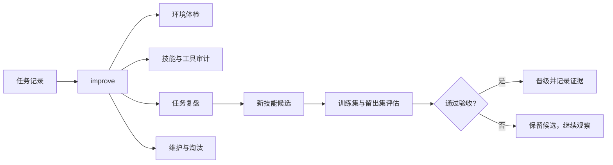

# evolution

> 让 Agent 自动发现拖累它的旧技能和工具，复盘真实任务，生成新能力，并用可验证的结果决定是否采用。

[](https://github.com/yagami-lightzxy/dsh-evolution/releases)
[](https://github.com/yagami-lightzxy/dsh-evolution/actions)
[](LICENSE)
[](https://www.python.org/)

`evolution` 是一个本地优先的 Agent Skill。它管理整个能力集合，不只改一段提示词。

它会持续回答四个问题：

1. 当前环境、模型通道、插件和工具链有没有已经拖慢 Agent？
2. 哪些技能重复、失效、过时或长期带来负面结果？
3. 最近的失败和重复成功能不能变成更好的规则或新技能？
4. 一个技能变更是否真的提升了能力，而不是碰巧在练习题上得分更高？

## 适合什么场景

- 同时使用 DSH、Codex、Claude Code 或其他读取 `SKILL.md` 的 Agent。
- 本地技能越来越多，旧副本覆盖了新版本，或者模型上下文被无关内容占满。
- 希望 Agent 根据任务记录自己复盘，生成新技能，更新工具，并清理已经拖累工作的能力。
- 希望技能升级有训练集、留出集、成本和回退证据。

## 一次完整的改进循环



主入口只有一个：

```bash
python scripts/evolution.py improve --apply --online

# 检查并安装最新 Release
python scripts/evolution.py update --online --apply
```

它会依次完成环境检查、技能健康检查、审计、任务复盘、去重、来源更新、工具安装队列、技能生成和学习规则沉淀。

没有 `--apply` 时只生成计划和报告。长期运行可以用 Agent 原生自动化，或在没有原生调度的平台上安装 Windows 计划任务或 cron。周期任务会先检查并安装同 major 的最新 Release，再运行完整改进循环。

## 快速安装

先在仓库目录完成自检：

```bash
python scripts/evolution.py selfcheck --strict
```

安装到 DSH、Codex、Claude Code 和共享技能目录：

```bash
python scripts/evolution.py install --apply
python scripts/evolution.py doctor
```

Windows 一键安装：

```powershell
.\install.ps1 -Apply
```

POSIX 系统一键安装：

```bash
./install.sh --apply
```

## 最常用的四个命令

```bash
# 查看能力和运行环境
python scripts/evolution.py capabilities
python scripts/evolution.py envcheck --online

# 生成一次改进计划并执行
python scripts/evolution.py improve --apply --online

# 从任务记录中看出哪些工作值得固化成技能
python scripts/evolution.py reflect --days 30

# 验收一个技能候选
python scripts/evolution.py evaluate --input evaluation.json --apply
```

其他命令用于单独操作，例如 `health` 检查技能完整性，`fetch` 安装外部技能，`new` 生成技能骨架，`skills` 查看来源和使用情况，`update` 检查自更新，`rollback` 回退受管文件。

## 它会怎样处理旧技能

技能只有在有来源记录时才会进入自动维护。

- 内容相同的副本合并为一个规范源，其余位置使用链接。
- 来源明确、长期没有更新、没有使用记录的技能会进入隔离候选。
- 技能虽然被使用，但长期失败率达到配置阈值，也会进入隔离候选。
- 隔离目录保留来源和还原路径。超过保留期后可用 `improve --purge` 清理。
- 手写技能和无来源技能不会被自动淘汰。

这套规则让模型不再被过时能力拖着走，同时保留了恢复路径。

## 技能怎样晋级

`evaluate` 接收一次候选评估结果。最小输入如下：

```json
{
  "skill": "search-skill",
  "candidate": "C:/tmp/search-candidate/SKILL.md",
  "target": "C:/Users/me/.agents/skills/search-skill/SKILL.md",
  "train_before": [70, 71, 70],
  "train_after": [75, 76, 75],
  "holdout_before": [68, 69],
  "holdout_after": [72, 73],
  "functions_before": ["search", "verify"],
  "functions_after": ["search", "verify", "report"]
}
```

候选必须通过以下门槛：

- 基线多次运行的波动在允许范围内。
- 训练集增益超过设定效果量，并且超过测量噪声。
- 留出集不回退。
- 原技能的核心函数仍然存在。

需要更严格的评估时，可以额外提供 `security_before/after`、`ood_before/after`、`transfer` 和 `max_cost`。这些字段分别约束安全集、OOD 或迁移集、跨模型迁移和成本上限。

候选不会直接覆盖当前技能。通过后先创建快照和目标文件备份，再晋级。每次评估还会记录候选文件和目标文件的 SHA-256，方便重放和审计。

## 任务复盘和新技能

每条任务记录可以包含结果、质量、失败根因、使用的技能、模型和标签：

```bash
python scripts/evolution.py record \
  --task "weekly audit" \
  --outcome success \
  --quality 4.5 \
  --skill audit-skill \
  --tags audit,weekly
```

当同一工作流重复成功，`improve --apply` 会生成带来源记录的技能目录。先用 `verify` 验证结构，再用 `evaluate` 决定是否替换已有技能。

## 工具和插件

工具安装通过配置队列完成，结果包含命令、退出码和输出尾部：

```json
{
  "maintenance": {
    "install_queue": [
      {
        "kind": "tool",
        "name": "example-tool",
        "command": ["winget", "install", "--id", "Example.Tool", "--exact"]
      }
    ]
  }
}
```

插件升级沿用宿主的安装通道。`envcheck --online` 和 `plugins --online` 负责发现陈旧版本，`improve` 负责把结果放进维护报告。

## 多 Agent 共享

| Agent | 入口 |
|---|---|
| DSH | `~/.dsh/skills/evolution` |
| 通用 Agent | `~/.agents/skills/evolution` |
| Claude Code | `~/.claude/skills/evolution` |
| Codex | `~/.codex/skills/evolution` |
| MCP 客户端 | `python scripts/evolution.py mcp` |

安装后这些入口可以链接到同一个规范源。运行时数据保存在 `~/.agents/evolution`，包括配置、指标、快照、报告、备份、日志和调度状态。

## 为什么采用这些机制

同类项目已经证明，技能进化最容易被三件事欺骗：测量噪声、练习集过拟合和模型自评。`evolution` 将多次运行、留出集、函数保留、隐藏安全集、迁移集、成本上限、来源追踪和可回退记录合并到一条本地工作流里。

它保留了环境治理和跨 Agent 同步能力，同时把技能质量优化留给可重放的评估数据。简单任务不会因为加载完整 Skill 而占用上下文，只有相关能力才按需读取。

## 运行时目录

```text
~/.dsh/skills/evolution/        # DSH 规范源
~/.agents/evolution/            # 运行时状态
  config.json                   # 配置
  state/                        # 指标、快照、评估、计划、锁
  reports/                      # 周报、审计、环境体检
  knowledge/                    # 长期经验
  backups/ logs/ bin/           # 备份、日志、调度脚本
```

## 验证

```bash
python -m unittest discover -s tests -v
python scripts/evolution.py selfcheck --strict
python scripts/evolution.py doctor
```

当前测试覆盖 73 项，包含技能发现、环境审计、快照回退、工具队列、任务复盘、技能生成、评估门槛、隔离清理、自更新和完整改进闭环。

## 详细文档

- [`SKILL.md`](SKILL.md) 说明 Agent 何时触发本技能以及默认闭环。
- [`references/commands.md`](references/commands.md) 列出完整命令和参数。
- [`references/architecture.md`](references/architecture.md) 说明数据流和状态目录。
- [`references/self-extension.md`](references/self-extension.md) 说明怎样安装或创建新能力。
- [`rules/security.md`](rules/security.md) 说明风险、来源和回退规则。

## License

MIT
