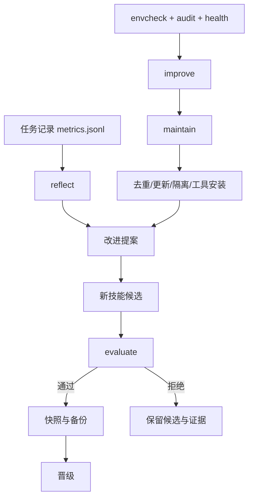

# 架构

## 一句话

`evolution` 把 Agent 的能力库当作一个持续维护的本地系统。代码在规范源里，任务证据和运行状态在运行时目录里，技能替换由评估结果决定。

## 主要路径

## 代码分层

| 层 | 代码 | 作用 |
|---|---|---|
| 入口 | `SKILL.md`、`templates/AGENTS.block.md` | 触发条件、默认改进闭环、全局规则 |
| 发现 | `discover.py`、`recommend.py` | 盘点技能、MCP、插件、运行时和依赖 |
| 体检 | `envcheck.py`、`audit.py`、`skill_health.py` | 找到会拖慢模型的环境和技能问题 |
| 复盘 | `metrics.py`、`experience.py`、`evolve.py` | 从任务结果提取失败模式和新技能提案 |
| 维护 | `maintenance.py`、`skill_sources.py`、`fetch.py` | 去重、来源更新、隔离、恢复、工具队列 |
| 评估 | `evaluation.py` | 多次运行、噪声、留出集、安全集、迁移和成本门槛 |
| 状态 | `paths.py`、`snapshot.py`、`schedule.py`、`updater.py` | 快照、备份、自更新、报告、锁和周期运行 |

## 一个规范源，多个 Agent 入口

规范源默认放在 `~/.dsh/skills/evolution`。安装会把 `.agents`、`.claude` 和 `.codex` 的入口链接到它。这样修复一次，所有 Agent 读取同一份技能和规则。

运行时数据放在 `~/.agents/evolution`。它保存配置、指标、评估记录、改进计划、快照、备份、报告、日志和调度脚本，不混入技能代码。

## `improve` 做什么

`autonomy.py` 把现有能力组合成一条路径：

1. `envcheck` 判断运行时、模型通道、插件和工具链是否过旧。
2. `audit` 和 `health` 检查技能、MCP、权限、引用和脚本。
3. `maintenance` 生成维护动作并处理配置好的工具队列。
4. `reflect` 从任务记录生成修复、优化和新技能提案。
5. `evolve` 把有证据的失败模式写入长期规则。
6. `skills` 根据来源、使用和失败率提出隔离候选。
7. `update` 检查 GitHub Release，通过验证后更新规范源。
8. 受管技能可生成、评估、晋级、恢复或清理。

单独的 `review` 仍然保留周报入口。自动化调度默认执行 `improve --apply --online`，因为它包含完整闭环。

## 评估数据

`evaluation.py` 不绑定模型供应商。执行器只需要把结果写成 JSON，评估器就能复用同一套门槛：

- 基线和候选的多次运行分数。
- 训练集和留出集分数。
- 变更前后的核心函数。
- 可选的安全集、OOD/迁移集、跨模型结果和成本上限。

通过后才会创建快照、备份目标文件并替换当前技能。评估记录保存候选和目标文件的 SHA-256，方便之后重放。

## 技能退役

有来源的技能才会被自动处理。隔离条件包含长期未更新、没有使用记录，或使用后持续失败。每个隔离条目都带来源和原路径，`skills --restore` 可以恢复。超过保留期后，`improve --purge` 才会清理隔离目录。

## 调度

优先使用 Agent 平台原生自动化。没有原生调度时，`schedule install --driver os --apply` 创建当前用户的 Windows 计划任务或带标记的 cron。计划任务调用 `improve --apply --online`，日志写入运行时目录。

## 扩展方式

- 新 Agent 在 `config.skill_roots` 增加路径、优先级和名称。
- 新工具放进 `maintenance.install_queue`，不需要新增一套安装框架。
- 新技能可以用 `new` 创建，再由 `verify` 和 `evaluate` 验收。
- 新评估信号直接加入评估输入，不改变主循环。
- 新环境检查在 `envcheck.py` 增加检查函数并注册到检查顺序。
